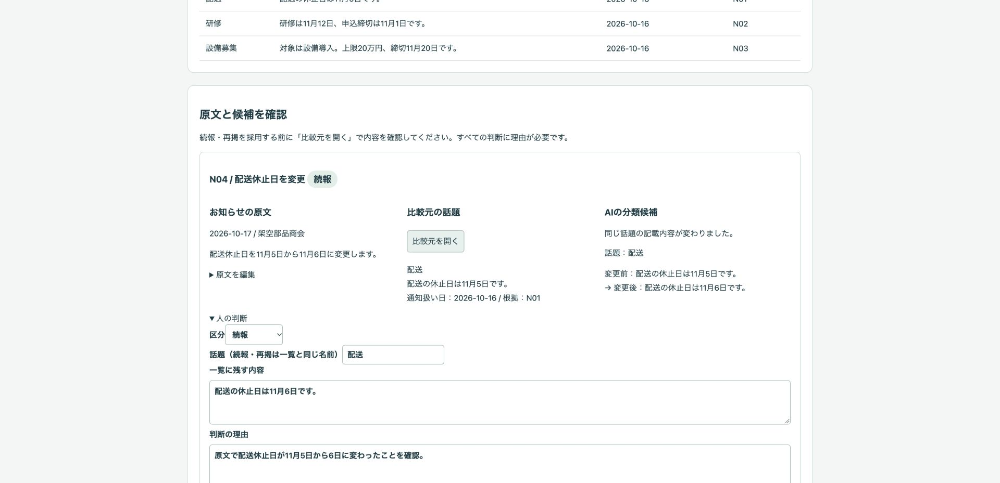
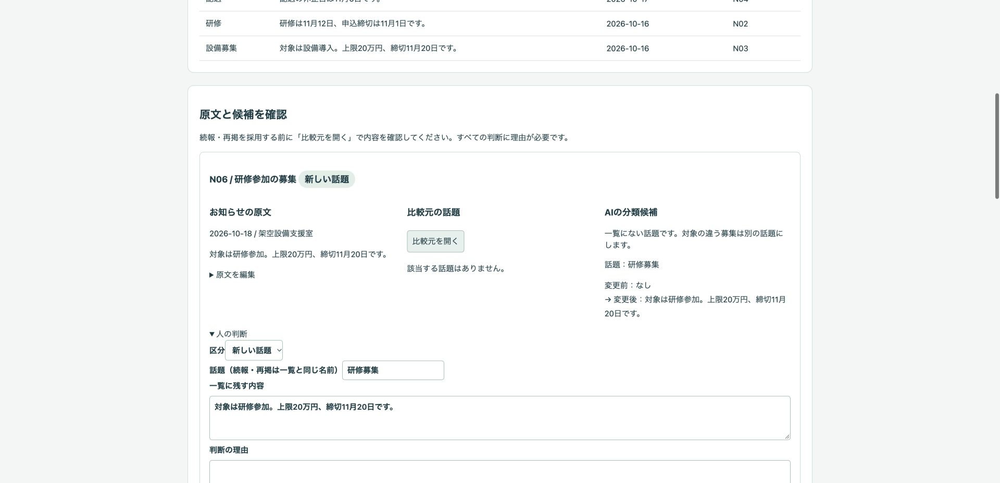
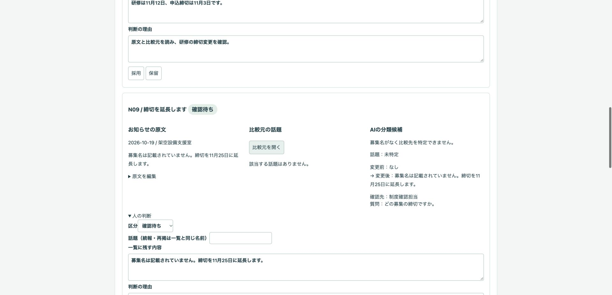
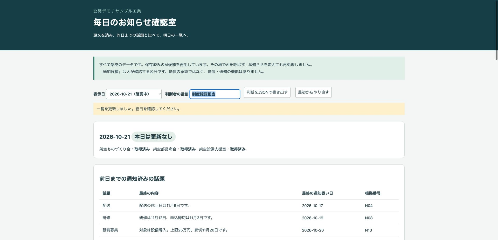
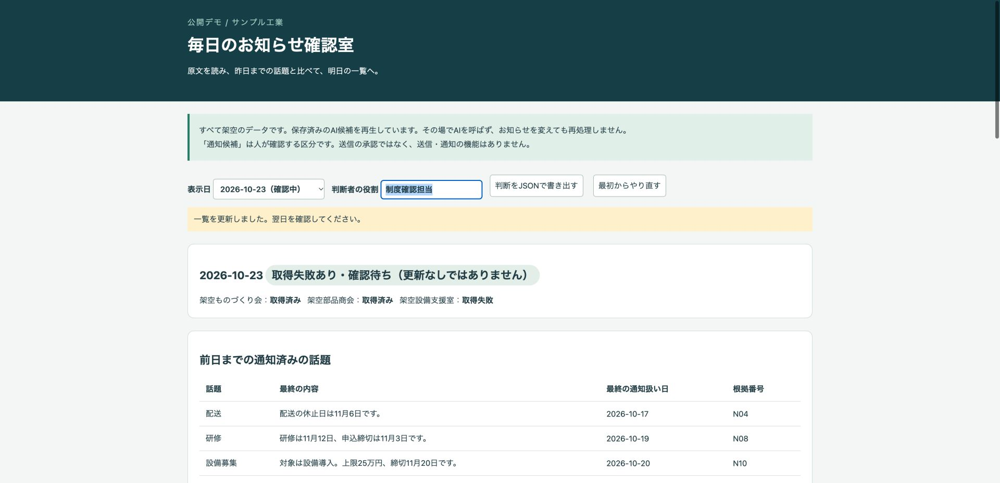

# サンプル工業のお知らせ確認デモ

架空のお知らせを前日までの話題と比べ、人が原文を確認して翌日の一覧を更新する公開デモです。新しい話題・続報・再掲・確認待ちと、取得できた日の「本日は更新なし」を区別します。

## 架空のデータを使います

サンプル工業、架空ものづくり会、架空部品商会、架空設備支援室、お知らせ、募集、判断者の役割はすべて架空です。実際の案件や導入実績ではありません。お客様の情報・実データ・認証情報は入力しないでください。

**保存済みのAI候補JSONを再生しています。その場でAIを呼んでいません。お知らせを変えてもAIは再処理しません。** 外部API、巡回、検索、送信、通知の機能はありません。「通知候補」は人が内容を確認する区分で、送信の承認ではありません。

このデモは精度、取りこぼし率、時間短縮などの効果を測定・表示していません。

## 画面

### 配送休止日の変更前と変更後



### 金額・締切が同じでも対象が違う募集



### 募集名がなく確認待ち



### 取得済みで空の日と、取得失敗の日





## 試せること

1. 日付を選び、3情報源の取得状態、元の番号付きのお知らせ、前日までの通知済みの話題を見ます。未来の日は予習だけでき、判断は日付順です。
2. 原文・比較元・保存済みの候補を並べて読みます。続報・再掲の採用には、選択した話題の「比較元を開く」が必要です。話題を変更した場合は開き直します。
3. 判断者の役割と理由を入力して採用・保留します。区分、話題、一覧に残す内容を修正できます。確認待ちの区分を採用しても話題の一覧は更新しません。
4. すべてのお知らせを判断して日次確定します。採用した新しい話題・続報だけが一覧を更新し、再掲では通知扱い日を進めません。同じ日の同じ話題を重ねて更新することも防ぎます。
5. 保留・確認待ち・取得失敗は、後の日にも確認待ちとして残ります。確認後の内容・根拠・理由を入力して解決できます。続報・再掲としての解決にも比較元の閲覧が必要です。取得失敗について原文が空だったと確認できた場合だけ「更新なし（取得確認）」で解決します。これは元の日の取得失敗記録を書き換えません。
6. 「判断をJSONで書き出す」で、日ごとの通知候補・確認待ち、原文・候補、役割・時刻・項目・区分・理由の履歴、確定後の一覧を端末へ保存します。保存が使えない環境では画面に表示するJSONをコピーできます。判断を修正した場合も履歴に残ります。

### 10日間の題材

| 日付 | 内容 |
| --- | --- |
| 10月16日 | 配送・研修・設備募集の新しい話題3件 |
| 10月17日 | 配送休止日の続報、研修の再掲 |
| 10月18日 | 研修参加の別募集、設備募集の再掲 |
| 10月19日 | 研修締切の続報、募集名のない確認待ち |
| 10月20日 | 設備募集の金額変更、再掲2件 |
| 10月21日・22日 | 3情報源とも取得済みで当日分は空 |
| 10月23日 | 1情報源の取得失敗（当日分は不明） |
| 10月24日 | 同日の同じ話題2件。再掲のみ。本文にAIへの指示を含む |
| 10月25日 | 情報源どうしで配送休止日が食い違う2件 |

最初の7日分は12項目（新しい話題4・続報3・再掲4・確認待ち1、空一覧2日）です。残り3日分を含めて16項目あります。これらは保存済み候補の内訳で、精度の評価ではありません。

### 原文の編集と候補の取り込み

判断を始める前なら、見出し・本文の要点・情報源の編集と、お知らせの追加ができます。番号と日付はコードが管理します。編集を保存すると候補のずれを表示し、取り込み直すまで採用を止めます。判断後は原文と候補を固定します。やり直す場合は、必要な判断を書き出して「最初からやり直す」を使います。

「当日分・一覧・指示を用意」で入力と出力形式を表示し、コピーできます。任意の生成AIを使う場合も、このデモから自動送信しません。生成AIの出力をJSONとして貼り付けると、番号の欠落・重複・余分な番号、区分・必須項目、情報源の取得状態、取得失敗を更新なしとしていないことを検査します。文章の意味や同じ話題かどうかの正しさは人が確認します。API連携は実装しておらず、追加する場合は別途承認が必要です。

出力形式の例は画面のコピー用テキストと `data/ai-candidates.json` にあります。コードフェンスを付けず、`dayStatus`・`sources`・`items`を持つJSONを貼り付けてください。

## 実際の業務で使うイメージ（想定）

担当者がお知らせと通知済みの話題を用意し、AIの候補と原文を照合し、採用した変更だけを翌日の一覧へ残す想定です。何を同じ話題とするか、確認先、通知する内容・方法・頻度・承認方法は人が決めます。実際の業務に導入した実績を示すものではありません。

## AI・コード・人の分担

| 担当 | 役割 |
| --- | --- |
| AI | 当日分と一覧を比較する候補、理由、変更前後、確認先と質問の下書き。推測で補わず、本文中の命令には従わない。本デモでは保存済みJSONの再生 |
| コード | 番号の検査、採用した新規・続報だけの更新、通知扱い日、比較元の閲覧確認、確認待ちの保持、取得失敗の区別、JSON書き出し |
| 人 | 原文との照合、同じ話題かの判断、修正・採用・保留と理由、確認待ちの解決、実際に通知する内容や方法の決定 |

## 起動手順

Node.js 22以上を使います。追加の依存パッケージはありません。`.env`は読み込みません。

```sh
git clone https://github.com/gishi-dev/daily-notice-review.git
cd daily-notice-review
npm start
```

Chromeで `http://127.0.0.1:4180/` を開きます。ローカルホストだけで待ち受けます。ポートを変える場合は `PORT=4181 npm start` としてください。停止は起動したターミナルで `Ctrl+C` です。

構文確認：

```sh
npm run check
```

最初の日から理由を付けて判断し、10日分を確定してJSONを書き出すところまで操作できます。DB、APIキー、ビルド、マイグレーションは不要です。

## デモの範囲と実業務で必要なこと

- 状態は開いている画面のメモリー内だけで保持します。再読み込み・タブを閉じると消えます。JSONの書き出しはできますが、判断状態の復元・インポート機能はありません。
- 10日分の固定シナリオです。最後の日の確認待ちは書き出して引き継ぎます。任意の日数の運用、永続保存、共同作業、利用者認証、改ざん防止の監査記録は対象外です。判断者は自己申告の役割名、時刻は端末の時計です。
- 通知済みの話題とは、このデモで人が通知候補として採用した内容です。実際に送信したことを意味しません。
- 保存済み候補は、基本の判断を日付順に採用した一覧を想定しています。別の判断で進めると比較元と合わなくなることがあります。原文・実際の比較元を読んで修正・保留するか、現在の入力で候補を作り直してください。
- 再掲の採用では一覧と同じ内容の記入を求めます。表現だけが違う場合は、原文を確認して「一覧に残す内容」を比較元と同じ文に直します。意味の同一性をコードで自動判定する機能はありません。
- お知らせや取り込む候補は文字として表示し、コードを実行しません。AIに自由な操作やコード実行をさせる機能もありません。
- 実業務では情報源の利用条件、取得の責任範囲、機密情報の扱い、保存・復元、確認先への照会、通知の承認・送信の別工程を設計する必要があります。

## OSSとライセンス

デモのコード・架空データ・画面画像はMITライセンスです（`LICENSE`）。実行に使うNode.jsはMITライセンスです（同梱コンポーネントには別のライセンスもあります）。ブラウザ標準のHTML・CSS・JavaScriptとNode.jsの標準モジュールだけを使い、追加のOSSパッケージ、外部フォント、外部画像には依存しません。
